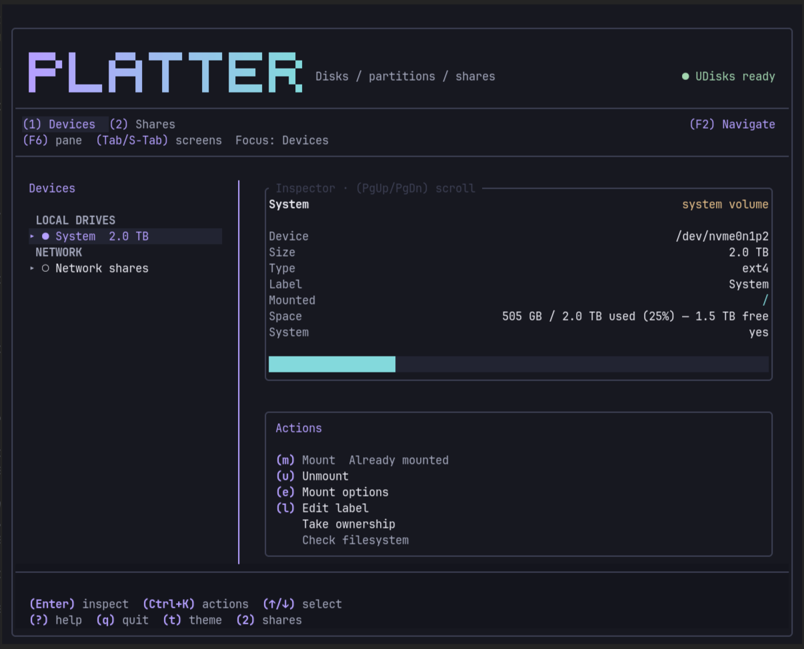

# Platter



A terminal disk manager for Linux. It covers the work GNOME Disks does — partitions, filesystems, LUKS, RAID, SMART, benchmarks, and disk images — and adds network shares in `/etc/fstab`. The interface follows the live Omarchy theme when one is installed.

Disk changes go through UDisks2, the same service GNOME Disks uses. Polkit asks for permission. The program itself does not stay root. Editing `/etc/fstab` and mounting a network share use `sudo`, and the screen steps aside so the password prompt is visible.

## Install

Rust and a running UDisks2 are required. Network filesystems need their mount helpers (`cifs-utils`, `nfs-utils`, `sshfs`).

```bash
curl -fsSL https://raw.githubusercontent.com/design-nexus/platter/main/install.sh | bash
```

The binary is installed to `~/.local/bin/platter`. Pass `--prefix` to use another directory.

From a clone, `./install.sh` does the same build. `cargo build --release` leaves the binary at `./target/release/platter`.

`platter /path/to/image.img` attaches that file as a loop device and selects it.

## Screens

The left column lists drives, partitions, free space, loop devices, RAID arrays, and network shares. The right side shows a partition map, the details of the selection, and the actions that apply to it. An action that cannot run stays visible and says why.

`j` and `k` move the device list, including off Network shares. The actions pane lists the commands for a disk and for network shares. `Tab` changes Devices / Shares screens. `F6` moves between the list, Inspector, and Actions. `F2` opens Navigation. `?` lists the keys. `q` quits outside text input.

Destructive actions (format, delete, image restore, secure erase, NVMe sanitize, power off, write benchmark) ask you to type the kernel name, such as `nvme0n1p2`. A system disk — anything mounted at `/`, `/home`, or `/boot`, an active swap, or a volume UDisks marks as a system device — also asks you to type `system`.

## Network shares

The share screen edits `/etc/fstab` for SMB/CIFS, NFS, NFSv4, and SSHFS. A custom type covers anything else. Each entry can set `_netdev`, `nofail`, and `x-systemd.automount`.

A password is written to a root-owned `0600` file under `/etc/samba/` and referenced with `credentials=`. It is not written into fstab. Before the new file replaces `/etc/fstab`, the current file is copied to `/etc/fstab.bak.<timestamp>`. Lines that are not the edited share are copied through unchanged.

## Themes

The default theme is the live Omarchy theme, read from `~/.local/state/omarchy/current/theme/colors.toml`. Changing the theme with `omarchy theme set` updates platter while it is open.

`t` opens the theme list. Built-in themes are Catppuccin (Mocha, Macchiato, Frappé, Latte), Tokyo Night, Dracula, Gruvbox, Nord, and Rosé Pine, plus the terminal's own colors. The choice is saved in `~/.config/disktui/config.toml`.

A file at `~/.config/disktui/theme.toml` with the same keys Omarchy uses (`background`, `foreground`, `accent`, and the rest) is the Custom theme.

LVM volume groups are not managed here. This UDisks build does not expose them. A logical volume that already appears as a block device can be mounted and formatted like any other volume.

## Aurora interface

New installations use Aurora: charcoal surfaces, lavender focus, cyan data, quiet borders, and compact headers. Existing explicit theme choices and legacy config/data locations are retained. `Ctrl+K` searches actions; Esc closes the palette. Actions use the same confirmations as their keyboard shortcuts. Tab / Shift+Tab changes screens; F6 / Shift+F6 changes panes. F2 opens Navigation. Details scroll with Page Up / Page Down. Narrow layouts show the active pane; the minimum terminal is 30×14.

Build requirements: Rust 1.88 or newer, Ratatui 0.30.2, Crossterm 0.29. Run `cargo test --locked` before `./install.sh`. The command is `platter`; no compatibility command aliases are installed.

See [shared navigation](docs/navigation.md) for keyboard and mouse controls.

Screenshot refreshed from an actual Foot render with sample data.
